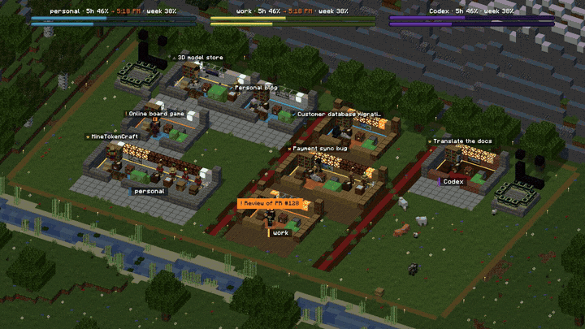
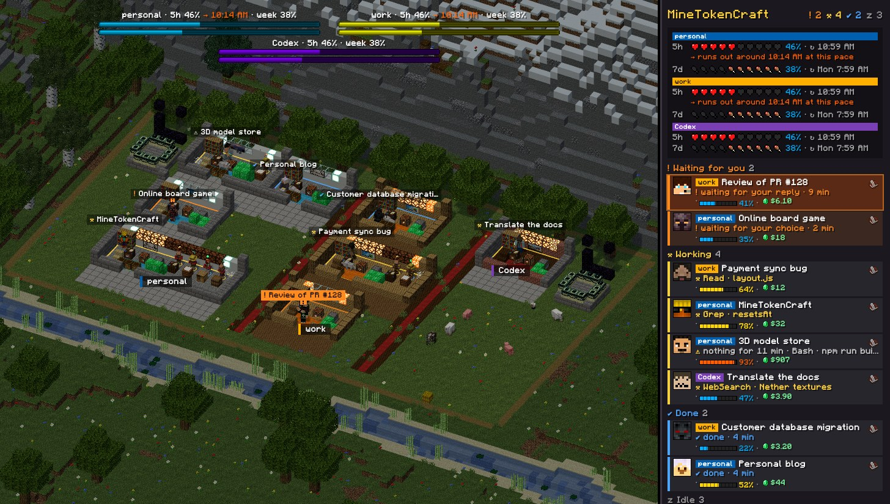
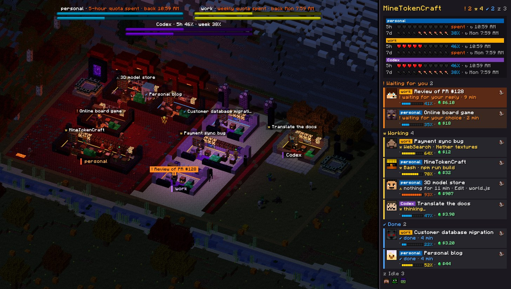
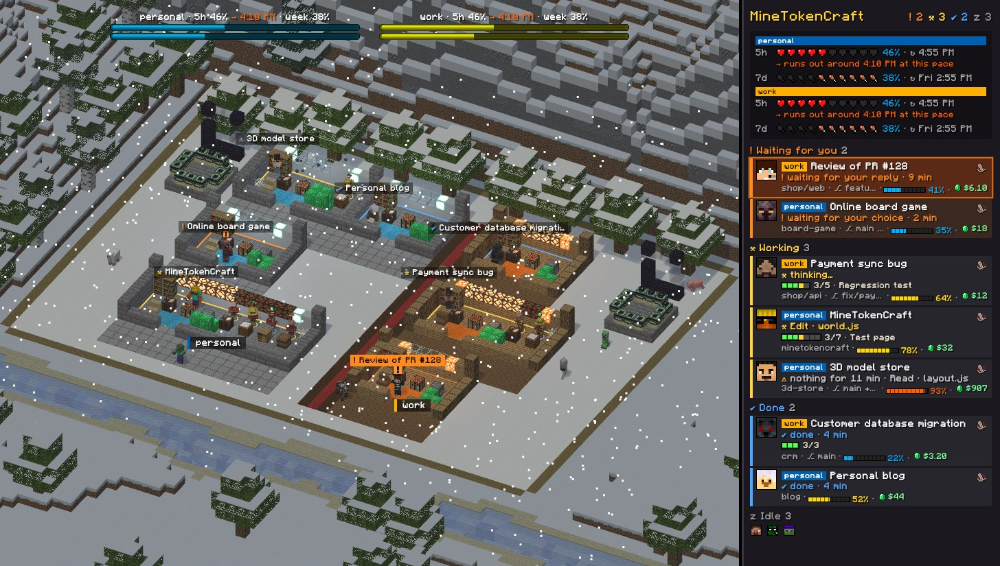
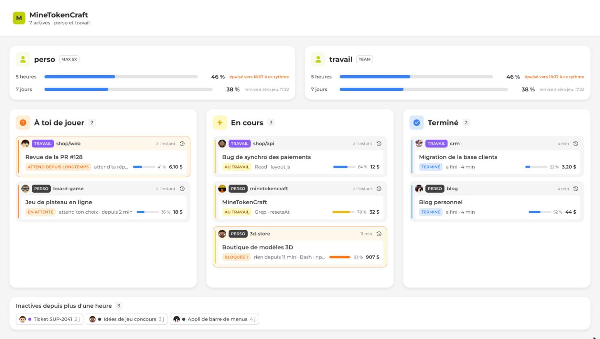

<div align="center">


# MineTokenCraft

**Suis en direct toutes tes sessions Claude Code, dans un village Minecraft en 3D.**
Qui travaille, qui t'attend, qui a fini, à quel point chaque contexte est rempli, ce que ça coûte, et le quota qui reste sur chacun de tes comptes. D'un coup d'œil, sur un seul écran.

[](https://github.com/KillianHzr/minetokencraft/actions/workflows/check.yml)
[](LICENSE)
[](https://nodejs.org)
[](#prérequis)
[](https://docs.anthropic.com/fr/docs/claude-code)
[](https://threejs.org)
[](#contribuer)

**[▶ Essayer la démo en ligne](https://killianhzr.github.io/minetokencraft/)**, avec des sessions factices, directement dans ton navigateur.

[English](README.md) · Français



</div>

> [!NOTE]
> Tout tourne sur ta machine. Le serveur n'écoute que sur `127.0.0.1`, et rien de tes sessions n'en sort.
> L'interface parle anglais et français : elle suit la langue du navigateur, et la barre d'outils permet d'en changer.

## Sommaire

- [Fonctionnalités](#fonctionnalités)
- [Prérequis](#prérequis)
- [Démarrage rapide](#démarrage-rapide)
- [Commandes](#commandes)
- [Comptes et quotas](#comptes-et-quotas)
- [Lire le village](#lire-le-village)
- [Mode simple](#mode-simple)
- [Configuration](#configuration)
- [Confidentialité et sécurité](#confidentialité-et-sécurité)
- [Performances](#performances)
- [FAQ](#faq)
- [Contribuer](#contribuer)
- [Avertissement](#avertissement)
- [Licence](#licence)

## Fonctionnalités

- 🏠 **Une aile par compte, une pièce par session.** Chaque session Claude Code est un joueur avec un vrai skin Minecraft ; chaque sous-agent est un villageois qui travaille à son bloc de métier, dans la même pièce.
- 🚦 **Un état lisible depuis l'autre bout de la pièce.** T'attend (orange, il fait signe, avec un `!` qui grossit à mesure que l'attente dure), travaille (jaune, au meuble de l'outil utilisé), a fini (bleu, assis dans le fauteuil), peut-être bloqué (fumée noire).
- 📊 **Les quotas de chaque compte.** L'utilisation sur 5 heures et sur la semaine en barres de boss Minecraft en haut de l'écran, avec une prévision de l'heure à laquelle le quota 5 h sera épuisé à ce rythme. Un compte qui atteint sa limite de 5 h envoie toute son aile dans le **Nether** ; sa limite de la semaine, dans l'**End**.
- 🧠 **Contexte, tâches et coût par session.** Une barre d'expérience pour la fenêtre de contexte, des toiles d'araignée qui envahissent la pièce à mesure qu'elle se remplit, des lampes de redstone qui s'allument avec la liste de tâches, des blocs d'émeraude qui s'empilent avec le coût. Tout est lu dans les transcripts : rien à installer.
- 📈 **La consommation du jour et de la semaine.** Le coût ou les tokens heure par heure aujourd'hui, jour par jour sur 7 jours, par compte, comparés à une journée habituelle.
- 🌦️ **Un monde vivant.** La vraie heure, la vraie météo locale (pluie qui éclabousse le sol, orages, neige, brouillard qui monte sur les montagnes), un arc-en-ciel quand la pluie s'arrête, des torches qui éclairent le chemin la nuit, les saisons (prairies au printemps, feuilles d'automne, neige l'hiver), le vent dans l'herbe, des animaux le jour, des monstres la nuit : et tu peux les combattre à l'épée en diamant.
- 🏷️ **Discret.** Juste un nametag au-dessus de chaque joueur ; survole une pièce pour une infobulle façon Minecraft avec les détails.
- ♿ **Calme quand on le demande.** Avec *réduire les animations* activé dans le système : pas d'éclairs, pas de clignotements, eau et herbe immobiles, moins de particules.
- 🖱️ **Clique sur une pièce pour aller à son terminal** (Terminal, iTerm, IDE JetBrains sur macOS), ou ouvre l'historique de la session.
- 🧾 **Mode simple.** Un tableau de bord clair et épuré avec les mêmes informations, sans le jeu.
- ⚡ **Léger.** Environ 200 appels de dessin par image, 30 i/s quand la fenêtre a le focus, 20 sinon, rien quand l'onglet est caché.

<table>
  <tr>
    <td colspan="2"></td>
  </tr>
  <tr>
    <td colspan="2" align="center"><sub>Une journée au village, chaque session au meuble de son outil</sub></td>
  </tr>
  <tr>
    <td width="50%"></td>
    <td width="50%"></td>
  </tr>
  <tr>
    <td align="center"><sub>Plus de quota : le Nether (5 h) et l'End (semaine), de nuit</sub></td>
    <td align="center"><sub>L'hiver, sous la neige</sub></td>
  </tr>
  <tr>
    <td colspan="2"></td>
  </tr>
  <tr>
    <td colspan="2" align="center"><sub>Mode simple</sub></td>
  </tr>
</table>

## Prérequis

- [Node.js](https://nodejs.org) 20 ou plus récent
- [Claude Code](https://docs.anthropic.com/fr/docs/claude-code), sur **macOS**, **Linux** ou **Windows**

| | macOS | Linux | Windows |
| --- | :---: | :---: | :---: |
| Village, mode simple, quotas, contexte, coût, consommation | ✓ | ✓ | ✓ |
| Notifications | ✓ | ✓ (avec `notify-send`) | |
| Démarrage à l'ouverture de session (`minetokencraft autostart`) | ✓ (launchd) | ✓ (systemd) | |
| Clic sur une pièce pour ramener son terminal | ✓ | | |
| Lecture de la connexion Claude Code dans le trousseau | ✓ | | |

Chaque modification est testée sur les trois systèmes.
- Un navigateur avec WebGL

## Démarrage rapide

```sh
npm install -g github:KillianHzr/minetokencraft
minetokencraft
```

Le premier lancement télécharge les textures Minecraft, la police et quelques skins dans `~/.cache/minetokencraft/assets` (environ 1 Mo), démarre le serveur en arrière-plan et ouvre <http://localhost:4747>. Relance `minetokencraft` quand tu veux : il réutilise le serveur qui tourne et ouvre simplement la page.

<details>
<summary>Depuis un clone</summary>

```sh
git clone https://github.com/KillianHzr/minetokencraft.git
cd minetokencraft
npm install
npm link        # rend la commande `minetokencraft` disponible
minetokencraft
```

</details>

Envie de voir avant ? La [démo en ligne](https://killianhzr.github.io/minetokencraft/) tourne dans ton navigateur avec des sessions factices dans tous les états, et permet de changer l'heure, la météo, la saison et le scénario de quota. `minetokencraft demo` ouvre la même page en local.

## Commandes

| Commande | Ce qu'elle fait |
| --- | --- |
| `minetokencraft` | Démarre le serveur si besoin et ouvre la page |
| `minetokencraft demo` | Ouvre la page de test, avec des sessions factices |
| `minetokencraft stop` | Arrête un serveur lancé par `minetokencraft` |
| `minetokencraft serve` | Lance le serveur au premier plan, journal dans le terminal |
| `minetokencraft autostart on` · `off` · `status` | Démarre le serveur à l'ouverture de session (macOS avec launchd, Linux avec systemd) |
| `minetokencraft assets [--refresh-skins] [--skins a,b,c]` | Retélécharge les ressources, ou d'autres skins |
| `minetokencraft statusline [--quiet]` | Commande de status line pour Claude Code (facultative, [voir plus bas](#status-line-facultative)) |

## Comptes et quotas

### Les comptes sont trouvés tout seuls

Un compte, c'est un dossier de config Claude Code. MineTokenCraft les trouve sans aucun réglage :

- `~/.claude` (celui par défaut) et `~/.config/claude`
- tous les dossiers `~/.claude-*` et `~/.claude_*`, la façon habituelle d'avoir plusieurs comptes
- les dossiers listés dans `CLAUDE_CONFIG_DIR`
- tout dossier ajouté dans les **Réglages**

Chacun a son aile, sa couleur et son style, dans cet ordre. Dans les **Réglages**, tu peux renommer un compte, le masquer ou ajouter un dossier.

### D'où viennent les quotas

1. **La connexion de Claude Code**, les mêmes chiffres officiels que `/usage`. Le jeton est lu dans `<dossier>/.credentials.json`, ou sur macOS dans le trousseau, **seulement une fois que tu l'as autorisé** pour ce compte dans les **Réglages** (macOS le demande alors une fois : choisis *Toujours autoriser*). MineTokenCraft ne rafraîchit ni ne garde jamais le jeton : il ne gêne jamais la connexion de Claude Code.
2. **Une clé de session claude.ai**, en secours : colle-la dans les **Réglages** pour un compte. Elle reste dans un fichier que toi seul peux lire, et ne repart jamais vers la page.
3. **La status line**, si tu l'installes (ci-dessous), en dernier recours.

Le contexte et le coût n'ont besoin de rien de tout ça : ils viennent des transcripts. Le contexte, c'est l'entrée de la dernière requête rapportée à la fenêtre du modèle (200 k, ou 1 M pour les modèles `[1m]`). Le coût chiffre chaque requête aux prix publics d'Anthropic, écritures de cache comprises (le cache d'une heure qu'utilise Claude Code coûte deux fois le prix de l'entrée), compte chaque requête une seule fois même quand elle est recopiée dans une session reprise, et inclut les sous-agents. C'est ce que les mêmes tokens coûteraient par l'API : un abonnement est facturé autrement.

<details>
<summary><a id="status-line-facultative"></a>Facultatif : la status line</summary>

Claude Code passe le contexte, le coût et les quotas de la session à sa commande de status line. MineTokenCraft peut en garder une copie, utile pour les quotas quand ni la connexion ni une clé de session ne sont disponibles. Dans `~/.claude/settings.json` (et dans chaque autre dossier de config) :

```json
{
  "statusLine": { "type": "command", "command": "minetokencraft statusline" }
}
```

Tu as déjà une status line ? Garde-la, et appelle MineTokenCraft sans affichage depuis ton script :

```sh
input=$(cat)
printf '%s' "$input" | minetokencraft statusline --quiet
# … ta propre status line, à partir de "$input"
```

</details>

## Lire le village

| Tu vois | Ça veut dire |
| --- | --- |
| Un nametag au-dessus d'un joueur | Le nom de la session, avec l'icône de son état ; survole la pièce pour tout le reste |
| Un joueur qui fait signe à l'avant de la pièce, `!` au-dessus de la tête, cadre orange | La session t'attend (autorisation, question). Au bout de 5 minutes, le nametag passe à l'orange, le `!` grossit et la cloche sonne de nouveau |
| Un joueur à un meuble, cadre jaune | Il travaille : bibliothèque pour réfléchir ou lire, fourneau pour les commandes, table de cartographie pour le web, établi pour modifier les fichiers |
| Un joueur dans le fauteuil, cadre bleu | Il a fini |
| De la fumée noire au-dessus de la pièce | Au travail mais rien d'écrit depuis 8 minutes : peut-être bloqué |
| Des villageois | Les sous-agents, au bloc de métier de leur type (Explore est cartographe, Plan bibliothécaire…) |
| Un loup ou un chat | L'animal de la session : le loup reste près de son joueur et remue la queue quand il travaille (plus vite quand il t'attend), le chat se promène et fait la sieste près du fauteuil une fois la session finie |
| Des lampes de redstone au mur du fond | L'avancement de la liste de tâches ; la tâche en cours clignote |
| Des toiles d'araignée | La fenêtre de contexte qui se remplit (60, 75, 85, 95 %) |
| Des blocs d'émeraude | Le coût de la session, un de plus à chaque fois qu'il double |
| Un tableau au mur du fond | La session tourne depuis plus d'une heure |
| Des cadres sur les bureaux | Les deux outils que la session utilise le plus |
| Des coffres près du fauteuil | Les fichiers modifiés : un coffre, un deuxième à 20 modifications, un troisième à 60 ; le plus récent s'ouvre pendant l'écriture d'un fichier |
| Les barres de boss en haut | Le quota 5 h (en haut) et celui de la semaine (en bas) de chaque compte, qui se remplissent avec l'utilisation |
| Un cadre d'obsidienne et des yeux de l'Ender près de la maison | Les mêmes quotas, qui construisent un portail du Nether et un portail de l'End |
| Une aile transformée en Nether ou en End | Ce compte n'a plus de quota 5 h, ou plus de quota de la semaine |

Clique sur une pièce ou une carte pour ramener son terminal au premier plan. Double-clique sur une pièce pour zoomer dessus (de nouveau un double-clic, ou Échap, pour revoir tout le village). Clique sur un villageois, ou sur sa ligne dans le panneau, pour voir ce qu'a fait ce sous-agent. L'icône du livre ouvre l'historique de la session. **Focus** dans la barre d'outils assombrit tout sauf les sessions qui t'attendent. Et clique sur un monstre : il prend un coup d'épée en diamant, et réapparaît 5 secondes après sa mort.

## Mode simple

L'interrupteur **Mode simple** remplace le village par un tableau de bord clair : les quotas de chaque compte, puis *À toi de jouer*, *En cours*, *Terminé*, et les sessions inactives. Il se resserre pour tenir dans l'écran sans défiler. Le choix est retenu.

## Configuration

Tout se règle depuis la page (**Réglages**). Fichiers et variables d'environnement, pour référence :

| | Par défaut |
| --- | --- |
| Réglages (comptes, clés de session, ville, langue) | `~/.config/minetokencraft/settings.json` (`XDG_CONFIG_HOME` ; sous Windows `%APPDATA%\minetokencraft`) |
| Cache (copies de la status line, historique des quotas, journal du serveur) | `~/.cache/minetokencraft/` (`XDG_CACHE_HOME` ; sous Windows `%LOCALAPPDATA%\minetokencraft`) |
| Port | `4747` (`MINETOKENCRAFT_PORT`) |
| Lieu de la météo | La ville de ton fuseau horaire, ou celle choisie dans les **Réglages** |
| Langue | Celle du navigateur, ou celle choisie dans la barre d'outils ; les notifications et la ligne de commande la suivent |
| Skins | Une liste de créateurs Minecraft connus ; `minetokencraft assets --skins nom1,nom2` pour d'autres |

## Confidentialité et sécurité

- Le serveur n'écoute que sur `127.0.0.1`, et refuse les requêtes dont le `Host` n'est pas local (pas de rebinding DNS).
- Les requêtes qui modifient quelque chose doivent être en JSON, ce qu'un autre site ouvert dans ton navigateur ne peut pas envoyer.
- La page tourne sous une politique de sécurité du contenu (CSP) stricte : elle ne charge que ses propres scripts, styles, polices et images, et ne parle qu'au serveur local.
- Les clés de session et les jetons n'arrivent jamais jusqu'à la page. Les réglages sont enregistrés avec les droits `0600`.
- Les appels réseau de MineTokenCraft, et rien d'autre :
  - [Open-Meteo](https://open-meteo.com) pour la météo (sans clé, seulement les coordonnées d'une ville) ;
  - Anthropic (`api.anthropic.com`) et, si tu as mis une clé de session, `claude.ai`, pour tes quotas ;
  - GitHub, jsDelivr et Mojang, une fois, pour télécharger les textures, les polices et les skins. La page elle-même n'appelle jamais aucun autre site (ni Google Fonts, ni CDN).
- Pas de télémétrie, pas de statistiques d'usage.

## Performances

La page est faite pour rester ouverte toute la journée :

- 30 i/s au plus, 20 quand la fenêtre n'a pas le focus, rien quand l'onglet est caché
- canvas plafonné à 1,25 fois la résolution de l'écran
- chaque personnage est un seul maillage à os ; particules, blocs et décors sont instanciés : environ 200 appels de dessin par image
- ombres recalculées 10 fois par seconde, sur la maison seulement
- lampes des pièces allumées seulement à la tombée du jour

`minetokencraft.perf()` dans la console du navigateur affiche les appels de dessin et le temps par image.

## FAQ

<details>
<summary><b>Aucun quota ne s'affiche pour un compte</b></summary>

Ouvre les **Réglages**. Si la connexion du compte est dans le trousseau macOS, clique sur **Autoriser la lecture** et choisis *Toujours autoriser* dans la fenêtre de macOS. Sinon, colle une clé de session claude.ai, ou installe la [status line](#status-line-facultative).

</details>

<details>
<summary><b>macOS me demande mon mot de passe ou l'accès au trousseau</b></summary>

C'est la demande du trousseau pour lire la connexion de Claude Code, qui n'arrive qu'une fois que tu l'as autorisée dans les **Réglages**. Choisis *Toujours autoriser* pour qu'elle ne revienne pas. Clique sur **Ne plus lire** pour l'arrêter.

</details>

<details>
<summary><b>Cliquer sur une pièce ne sélectionne pas le bon onglet de terminal</b></summary>

Terminal et iTerm reçoivent l'onglet exact. Les IDE JetBrains ne laissent MineTokenCraft ramener que la bonne fenêtre de projet : l'onglet de terminal à l'intérieur reste à choisir à la main. Les tâches de fond n'ont pas de terminal.

</details>

<details>
<summary><b>La page est vide</b></summary>

Aucune session Claude Code ne tourne, ou elles sont toutes inactives depuis plus d'une heure (elles sont alors listées dans le panneau de côté). `minetokencraft demo` montre à quoi ça ressemble avec des sessions.

</details>

<details>
<summary><b>Le port 4747 est déjà pris</b></summary>

`MINETOKENCRAFT_PORT=4800 minetokencraft`

</details>

## Contribuer

Les issues et les pull requests sont les bienvenues : voir [CONTRIBUTING.md](CONTRIBUTING.md) (en anglais) pour l'organisation du code et les règles, [CHANGELOG.md](CHANGELOG.md) pour les nouveautés de chaque version, et [SECURITY.md](SECURITY.md) pour signaler une faille en privé.

```sh
npm install
npm run check   # syntaxe de tous les fichiers, modules du serveur, traductions, contenu du paquet npm
npm test        # tests sur un faux dossier personnel : comptes, transcripts, coût, quotas, serveur
minetokencraft serve
```

Ouvre ensuite <http://localhost:4747/demo> pour voir tous les états sans vraies sessions. Pas d'étape de build : la page est en modules ES et [three.js](https://threejs.org).

L'interface est traduite dans `public/js/locales` (la page) et `lib/locales` (notifications, ligne de commande). L'anglais fait référence : un nouveau texte va dans toutes les langues, et `npm run check` échoue si les clés ou les variables diffèrent.

## Avertissement

MineTokenCraft est un projet indépendant, sans lien avec Anthropic, Mojang Studios ou Microsoft, ni approuvé par eux. *Claude* et *Claude Code* sont des marques d'Anthropic ; *Minecraft* est une marque de Mojang Studios. Les textures et les skins Minecraft ne font pas partie de ce dépôt : ils sont téléchargés sur ta machine depuis des sources publiques au premier lancement et y restent. Les skins appartiennent à leurs propriétaires.

## Licence

[MIT](LICENSE)
